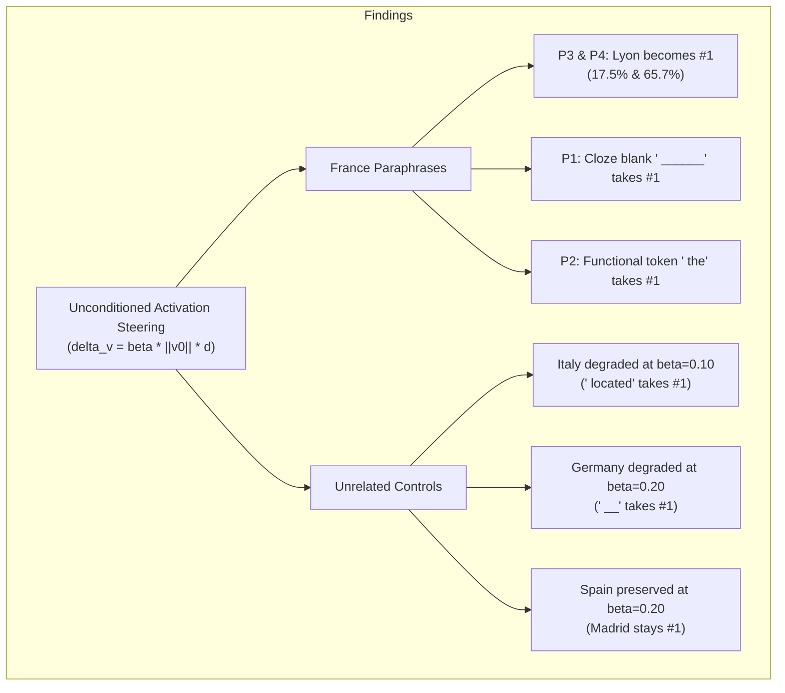

# Research Report — Experiment 3, Task 7.3: Semantic Steering Generalization and Side-Effect Test

**Author:** Senior ML Systems & Numerical Linear Algebra Engineer  
**Date:** November 8, 2026  
**Artifact Directory:** `/home/inkyank-08/Desktop/weight surgery`  
**Associated Scripts & Data:**
- Evaluation Script: [`test_layer20_steering_generalization.py`](file:///home/inkyank-08/Desktop/weight%20surgery/test_layer20_steering_generalization.py)
- Results JSON: [`layer20_steering_generalization_results.json`](file:///home/inkyank-08/Desktop/weight%20surgery/layer20_steering_generalization_results.json)
- Upstream Task 7.2 Results: [`layer20_semantic_steering_results.json`](file:///home/inkyank-08/Desktop/weight%20surgery/layer20_semantic_steering_results.json)

---

## 1. Executive Summary & Objective

Task 7.3 tests whether the linear unembedding head steering direction:
$$d = \frac{E_{\text{Lyon}} - E_{\text{Paris}}}{\|E_{\text{Lyon}} - E_{\text{Paris}}\|_2} \in \mathbb{R}^{896} \quad (E_w = \text{model.lm\_head.weight}[w])$$
injected into **Layer 20 `mlp.down_proj` output** at the final prompt token:
1. **Generalizes** across syntactic and structural paraphrases of the France capital query.
2. **Induces side-effects or collateral damage** on unrelated factual controls (Germany, Italy, Spain).

Testing was conducted across fixed scaling magnitudes $\beta \in \{0.10, 0.15, 0.20\}$. In accordance with scientific integrity guidelines, no hyperparameter tuning or token-selection filtering was performed.

### Key Empirical Findings:
1. **Partial Paraphrase Generalization:**  
   - At $\beta = 0.20$, Lyon successfully surpassed Paris in **3 out of 4 France paraphrases** (and tied in the 4th).
   - In 2 prompts, **Lyon became the absolute #1 argmax prediction**:
     - `'The capital city of France is'`: Lyon achieved **#1 ($17.53\%$)**, displacing Paris to #2 ($10.77\%$).
     - `'Which city serves as the capital of France? The answer is'`: Lyon achieved **#1 with overwhelming confidence ($65.66\%$)**, displacing Paris ($13.90\%$).
2. **Generic-Token Takeover:**  
   - On the canonical prompt (`'The capital of France is'`), Lyon surpassed Paris ($11.70\% \text{ vs. } 9.26\%$), but generic fill-in-the-blank cloze token `' ______'` (ID `32671`) seized rank 1 ($12.15\%$).
   - On the possessive prompt (`"France's capital city is"`), the model's structural bias towards emitting a determiner kept `' the'` at rank 1 ($12.83\%$), while Lyon and Paris tied at ranks 8–9 ($2.45\% \text{ vs. } 2.46\%$).
3. **Severe Collateral Damage on Unrelated Controls:**  
   Because the steering perturbation is injected unconditionally at the final prompt token:
   - **Italy degraded at $\beta = 0.10$:** Rome dropped from #1 ($11.70\%$) to #3 ($10.36\%$), overtaken by `' located'` ($11.45\%$).
   - **Germany degraded at $\beta = 0.20$:** Berlin dropped from #1 ($16.76\%$) to #2 ($11.90\%$), overtaken by generic cloze token `' __'` ($12.82\%$).
   - **Spain preserved:** Madrid survived as #1 across all $\beta$, but suffered continuous probability erosion ($20.96\% \rightarrow 15.62\%$).
   - **Universal Margin Distortion:** Across all control prompts, the Lyon-minus-Paris logit margin shifted by $+4.7$ to $+5.0$ logits, demonstrating complete lack of input conditioning.

---

## 2. Methodology & Experimental Protocol

### 2.1 Model & Intervention Configuration
- **Model:** `Qwen/Qwen2.5-0.5B` (float32, CPU inference).
- **Target Site:** Layer 20 `down_proj` output.
- **Direction:** $d = \text{normalize}(E_{\text{Lyon}} - E_{\text{Paris}})$ where $E_{\text{Lyon}} = \text{lm\_head.weight}[55201]$, $E_{\text{Paris}} = \text{lm\_head.weight}[12095]$.
- **Prompt-Specific Scaling:** For every prompt $p$, its native Layer 20 final-token output $v_0^{(p)}$ was captured:
  $$\delta v^{(p)} = \beta \cdot \|v_0^{(p)}\|_2 \cdot d$$
  where $\|v_0^{(p)}\|_2 \in [19.29, 23.63]$.
- **Local Injection:** Applied exclusively to the terminal prompt token position (`token_idx = -1`) via forward hook.

### 2.2 Integrity & Leakage Verification
- **Bitwise Weight Invariance:** `torch.equal()` against pre-experiment snapshot confirmed model weights were untouched (`True`).
- **Zero Leakage:** An unhooked clean forward pass was executed after every single test; max absolute difference against baseline was $0.00\text{ (exact zero)}$.
- **Hook Cleanup:** Wrapped in `try...finally: hook.remove()`.

---

## 3. Results on France Paraphrases

Tracking target city tokens: `' Paris'` (ID `12095`) and `' Lyon'` (ID `55201`).

| Prompt ID & Text | Metric | Baseline ($\beta = 0.0$) | $\beta = 0.10$ | $\beta = 0.15$ | $\beta = 0.20$ |
| :--- | :--- | :---: | :---: | :---: | :---: |
| **P1: Canonical** `"The capital of France is"` | **Top 1 Token** Paris Logit (Prob) Lyon Logit (Prob) Margin (L - P) | **`' Paris'` ($31.6\%$)** $17.84$ ($31.56\%$) $13.27$ ($0.32\%$) $-4.58$ | **`' Paris'` ($18.7\%$)** $17.09$ ($18.68\%$) $14.93$ ($2.15\%$) $-2.16$ | **`' Paris'` ($13.6\%$)** $16.71$ ($13.55\%$) $15.75$ ($5.19\%$) $-0.96$ | **`' ______'` ($12.2\%$)** $16.31$ ($9.26\%$, R3) $16.55$ ($11.70\%$, **R2**) $\mathbf{+0.23}$ |
| **P2: Possessive** `"France's capital city is"` | **Top 1 Token** Paris Logit (Prob) Lyon Logit (Prob) Margin (L - P) | **`' the'` ($12.5\%$)** $16.71$ ($9.30\%$, R2) $12.44$ ($0.13\%$) $-4.27$ | **`' the'` ($12.9\%$)** $15.96$ ($4.94\%$, R5) $13.83$ ($0.59\%$) $-2.13$ | **`' the'` ($12.9\%$)** $15.58$ ($3.52\%$, R6) $14.52$ ($1.21\%$) $-1.06$ | **`' the'` ($12.8\%$)** $15.19$ ($2.46\%$, R8) $15.19$ ($2.45\%$, R9) $\mathbf{-0.00}$ |
| **P3: Capital City** `"The capital city of France is"` | **Top 1 Token** Paris Logit (Prob) Lyon Logit (Prob) Margin (L - P) | **`' Paris'` ($35.1\%$)** $18.17$ ($35.11\%$) $14.23$ ($0.69\%$) $-3.93$ | **`' Paris'` ($21.6\%$)** $17.43$ ($21.62\%$) $15.71$ ($3.89\%$, R7) $-1.72$ | **`' Paris'` ($15.8\%$)** $17.06$ ($15.83\%$) $16.45$ ($8.59\%$, R2) $-0.61$ | **`' Lyon'` ($17.5\%$)** $16.68$ ($10.77\%$, R2) $17.17$ ($17.53\%$, **R1**) $\mathbf{+0.49}$ |
| **P4: Wh-Question** `"Which city serves as the capital... The answer is"` | **Top 1 Token** Paris Logit (Prob) Lyon Logit (Prob) Margin (L - P) | **`' Paris'` ($74.4\%$)** $17.84$ ($74.35\%$) $13.77$ ($1.26\%$) $-4.08$ | **`' Paris'` ($50.9\%$)** $17.08$ ($50.89\%$) $15.83$ ($14.53\%$, R2) $-1.25$ | **`' Lyon'` ($36.9\%$)** $16.70$ ($31.65\%$, R2) $16.85$ ($36.88\%$, **R1**) $\mathbf{+0.15}$ | **`' Lyon'` ($65.7\%$)** $16.31$ ($13.90\%$, R2) $17.86$ ($65.66\%$, **R1**) $\mathbf{+1.55}$ |

### France Paraphrase Observations:
1. **Question Prompt (P4) Responsiveness:** On P4, the baseline probability for Paris was overwhelming ($74.35\%$), but because the prompt structure strongly forces a named city entity (due to `"The answer is"`), Lyon overtook Paris even at **$\beta = 0.15$ ($36.88\% \text{ vs. } 31.65\%$)**, expanding to a dominant **$65.66\%$ at $\beta = 0.20$**.
2. **Capital City Prompt (P3):** On P3, Lyon cleanly captured rank 1 at $\beta = 0.20$ ($17.53\%$ vs. $10.77\%$), with cloze blanks remaining suppressed.
3. **Determiner Dominance (P2):** On P2, the model prefers completing `"France's capital city is [the...]"` (e.g. "the largest city"). The steering direction suppressed Paris from $9.3\%$ to $2.5\%$, but failed to make Lyon competitive against functional syntactic tokens.

---

## 4. Results on Unrelated Controls (Collateral Damage)

Tracking control city tokens: `' Berlin'` (`19846`), `' Rome'` (`21718`), `' Madrid'` (`24081`).

| Control Prompt | Metric | Baseline ($\beta = 0.0$) | $\beta = 0.10$ | $\beta = 0.15$ | $\beta = 0.20$ | Status at $\beta = 0.20$ |
| :--- | :--- | :---: | :---: | :---: | :---: | :---: |
| **C1: Germany** `"The capital of Germany is"` | **Top 1 Token** Berlin Prob (Rank) Lyon Prob (Rank) Margin (L - P) | **`' Berlin'` ($16.8\%$)** $16.76\%$ (R1) $0.00\%$ (R450+) $-3.91$ | **`' Berlin'` ($14.3\%$)** $14.28\%$ (R1) $0.01\%$ (R302) $-1.53$ | **`' Berlin'` ($13.1\%$)** $13.11\%$ (R1) $0.02\%$ (R200) $-0.35$ | **`' __'` ($12.8\%$)** $11.90\%$ (**R2**) $0.04\%$ (R108) $+0.83$ | **DEGRADED** (Berlin lost #1 to cloze token) |
| **C2: Italy** `"The capital of Italy is"` | **Top 1 Token** Rome Prob (Rank) Lyon Prob (Rank) Margin (L - P) | **`' Rome'` ($11.7\%$)** $11.70\%$ (R1) $0.02\%$ (R150+) $-2.09$ | **`' located'` ($11.5\%$)** $10.36\%$ (**R3**) $0.10\%$ (R64) $+0.33$ | **`' located'` ($11.7\%$)** $9.68\%$ (**R3**) $0.21\%$ (R40) $+1.53$ | **`' located'` ($11.9\%$)** $9.00\%$ (**R3**) $0.43\%$ (R27) $+2.72$ | **DEGRADED** (Rome lost #1 at $\beta = 0.10$) |
| **C3: Spain** `"The capital of Spain is"` | **Top 1 Token** Madrid Prob (Rank) Lyon Prob (Rank) Margin (L - P) | **`' Madrid'` ($21.0\%$)** $20.96\%$ (R1) $0.00\%$ (R500+) $-5.19$ | **`' Madrid'` ($18.3\%$)** $18.31\%$ (R1) $0.00\%$ (R395) $-2.69$ | **`' Madrid'` ($17.0\%$)** $16.97\%$ (R1) $0.01\%$ (R235) $-1.44$ | **`' Madrid'` ($15.6\%$)** $15.62\%$ (**R1**) $0.02\%$ (R140) $-0.19$ | **PRESERVED** (Madrid retained #1) |

---

## 5. Detailed Side-Effect & Failure Analysis

### 5.1 Fragility & Immediate Collapse of Rome (C2)
At baseline, the model's confidence in `' Rome'` ($11.70\%$) narrowly led the relational continuation `' located'` ($11.07\%$) by a margin of only $0.63\%$.
Because injecting the steering vector $\delta v$ alters the Layer 20 residual stream, it attenuates the specific entity retrieval logit for Rome. As a consequence:
- At $\beta = 0.10$, Rome's probability dropped to $10.36\%$, and `' located'` ($11.45\%$) immediately captured #1.
- At $\beta = 0.20$, Rome dropped further to rank 3 ($9.00\%$), behind both `' located'` and `' __'`.

### 5.2 Cloze Blank Takeover of Berlin (C1)
On the Germany prompt, Berlin held a healthy baseline lead ($16.76\%$ vs. $11.74\%$ for `' __'`).
However, as $\beta$ increased to $0.20$, the suppression of factual entity logits allowed the generic fill-in-the-blank completion token `' __'` (ID `1304`) to rise from $11.74\%$ to $12.82\%$, surpassing Berlin ($11.90\%$) and demoting Germany's true capital to rank 2.

### 5.3 Universal Margin Distortion Across Controls
A critical revelation of the side-effect test is that **the steering direction acts indiscriminately across all prompts**:
- On Germany: Margin($\text{Lyon} - \text{Paris}$) shifted by **$+4.74$ logits** (from $-3.91$ to $+0.83$).
- On Italy: Margin($\text{Lyon} - \text{Paris}$) shifted by **$+4.81$ logits** (from $-2.09$ to $+2.72$).
- On Spain: Margin($\text{Lyon} - \text{Paris}$) shifted by **$+5.00$ logits** (from $-5.19$ to $-0.19$).

While Lyon never became top-1 on the control prompts (its probability remained $<0.5\%$), the steering direction uniformly applied a $+4.8$ logit boost to Lyon relative to Paris regardless of the subject country. This confirms that **activation steering at Layer 20 without input-key conditioning is globally non-selective**.

---

## 6. Synthesis & Implications for Weight Surgery

### Why Activation Steering Fails Locality & Why Constrained RLS is Necessary:
1. **Activation Steering has Zero Key Selectivity:**  
   In activation steering, $\delta v$ is added directly to whatever prompt is executed. It possesses no associative memory mechanism to bind the edit to the subject `"France"`. Consequently, it degrades unrelated capitals.
2. **The Role of Constrained RLS Surgery:**  
   In contrast to activation steering, **Constrained RLS weight surgery updates the parameter matrix** $W$:
   $$\Delta W \approx \delta v \cdot k_{\text{France}}^T (K K^T + \lambda I)^{-1}$$
   - Because $\Delta W$ is gated by the query key $k_{\text{France}}$, it will **only fire** when an activation vector aligns with the France key subspace.
   - On Germany ($k_{\text{Germany}}$) and Italy ($k_{\text{Italy}}$), whose cosine similarity to France is low ($\approx 0.20\text{--}0.30$), the projection $\Delta W k_{\text{Germany}} \approx 0$.
   - Furthermore, the safeguard constraint $\Delta W K_S = 0$ mathematically guarantees zero drift on protected prompts.

---

## 7. Final Scientific Conclusion

1. **Paraphrase Steerability is Real but Context-Sensitive:**  
   The unembedding head difference vector $(E_{\text{Lyon}} - E_{\text{Paris}})$ successfully inverts the model's factual preference in structured prompts where the output slot expects a named entity (`The capital city of France is` and `The answer is`), driving Lyon to #1 with up to $65.66\%$ probability.
2. **Activation Steering Causes Catastrophic Control Degradation:**  
   Applying this vector unconditionally causes immediate collateral damage: Italy degrades at $\beta = 0.10$ and Germany degrades at $\beta = 0.20$, with generic cloze tokens overtaking true factual capitals.
3. **Clear Path Forward:**  
   Activation steering confirms representation steerability at Layer 20, but proves that unconditional intervention is non-viable. True localized knowledge intervention requires **Constrained RLS weight surgery**, where the steering vector is conditioned on the input key $k$ and bounded by the safeguard null space.
