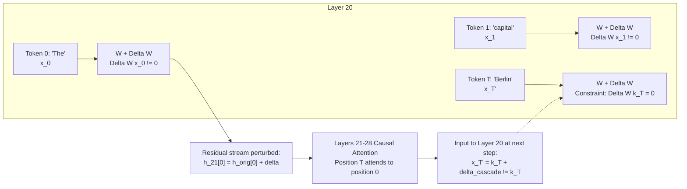

# Research Report — Experiment 3, Task 7.4: Constrained RLS Sequence-Wide Protection Audit

**Author:** Senior ML Systems & Numerical Linear Algebra Engineer  
**Date:** November 8, 2026  
**Artifact Directory:** `/home/inkyank-08/Desktop/weight surgery`  
**Associated Diagnostic Scripts & Data:**
- Diagnostic Script: [`audit_sequence_wide_safeguards.py`](file:///home/inkyank-08/Desktop/weight%20surgery/audit_sequence_wide_safeguards.py)
- Analysis Output: [`sequence_wide_safeguards_analysis.json`](file:///home/inkyank-08/Desktop/weight%20surgery/sequence_wide_safeguards_analysis.json)
- Solver Implementation: [`AuditedConstrainedRLS`](file:///home/inkyank-08/Desktop/weight%20surgery/Experiment-2.1-Robustness-Streaming-Audit/robustness_tests.py#L42-L246)
- Activation Capturer: [`QwenActivationCapturer`](file:///home/inkyank-08/Desktop/weight%20surgery/activation_capture.py)

---

## 1. Executive Summary

This read-only audit investigates the sequence-wide mechanics of safeguard protection in transformer MLPs and formulates the exact numerical requirements for preserving multi-token prompt representations during Constrained Recursive Least Squares (RLS) weight surgery on `Qwen/Qwen2.5-0.5B`, Layer 20 `mlp.down_proj`.

### Core Technical Conclusions:
1. **Global Weight Sharing Hazard:** In transformer architectures, the Layer 20 `down_proj` parameter matrix $W \in \mathbb{R}^{896 \times 4864}$ is shared across all token positions $t \in [0, T-1]$. When $W \leftarrow W + \Delta W$, the modification $\Delta W$ acts on **every token position** in subsequent forward passes.
2. **Final-Token Safeguard Insufficiency:** Safeguarding only the final prompt token ($k_{\text{final}}$) does **not** guarantee prompt preservation. If earlier tokens are unconstrained, $\Delta W x_t \ne 0$ injects perturbations at $t < \text{final}$. These perturbations cascade forward through subsequent causal self-attention layers ($j \le t$), corrupting the activation $k_{\text{final}}'$ before it ever reaches Layer 20 at the final position.
3. **Sequence-Wide Null-Space Feasibility:** For the 5 pilot safeguard prompts ($37$ total tokens), stacking all Layer 20 input activations into $K_S \in \mathbb{R}^{4864 \times 37}$ yields a numerical rank of **$31$** ($6$ dimensions are exact bitwise duplicates due to causal prefix sharing).
4. **Vast Parameter Null Space:** Constraining all 37 sequence-wide tokens consumes only $31$ dimensions of the 4864-dimensional space, leaving a reduced coordinate update space of **$d_{\text{red}} = 4833$ ($99.36\%$ unconstrained)**.
5. **Zero-Code Solver Compatibility:** [`AuditedConstrainedRLS`](file:///home/inkyank-08/Desktop/weight%20surgery/Experiment-2.1-Robustness-Streaming-Audit/robustness_tests.py#L42-L246) natively ingests this expanded matrix out-of-the-box in $2.47\text{ seconds}$, achieving **$4.34 \times 10^{-16}$ post-update safeguard error** across all 37 tokens.

---

## 2. Answers to Specific Technical Questions

### Question 1: Does the constrained RLS update modify Layer 20 `down_proj` globally across all sequence positions?
**YES.**  
In PyTorch transformer architectures (`Qwen2MLP`), the feed-forward projection is implemented as:
$$\text{down\_proj}(X) = X W^T \quad \text{where } X \in \mathbb{R}^{B \times T \times 4864}, \; W \in \mathbb{R}^{896 \times 4864}$$
When Constrained RLS updates the weight matrix:
$$W' = W_0 + \Delta W$$
the update is stationary and global. During any subsequent inference forward pass, every token position $t \in \{0, \dots, T-1\}$ in the sequence is multiplied by $W'$:
$$y_t' = W_0 x_t + \Delta W x_t$$
There is no sequence-position masking inside the linear layer.

---

### Question 2: Does existing safeguard extraction capture only final tokens or all token positions?
- **High-level method (`extract_safeguards` in [`activation_capture.py#L358-L430`](file:///home/inkyank-08/Desktop/weight%20surgery/activation_capture.py#L358-L430)):**  
  Captures only the token(s) matching `target_substring` (defaulting to a single column vector via `span_token_policy="last"`). It extracts $m$ columns for $m$ prompts ($K_S \in \mathbb{R}^{4864 \times m}$).
- **Core engine (`capture` in [`activation_capture.py#L203-L205`](file:///home/inkyank-08/Desktop/weight%20surgery/activation_capture.py#L203-L205)):**  
  **Already supports full-sequence extraction.** Specifying `token_position="all"` extracts the complete input tensor of shape `[seq_len, 4864]` and output tensor `[seq_len, 896]` for all token positions in one forward pass.

---

### Question 3: Does safeguarding only final-token keys guarantee prompt preservation?
**NO. Mathematical & Architectural Proof of Failure:**



1. If only $k_{\text{final}}$ is constrained, $\Delta W x_t \ne 0$ for $t < \text{final}$.
2. The residual stream at early tokens is perturbed: $h_{21}[t] = h_{21, \text{orig}}[t] + \Delta W x_t$.
3. In subsequent layers (Layers 21 through 27), multi-head self-attention computes:
   $$\text{Attn}(Q_{\text{final}}, K_{0..T}, V_{0..T})$$
   Because keys and values of earlier tokens are corrupted, the attention output at the final token is corrupted.
4. When the model generates autoregressively, the prompt's internal state drifts, leading to degraded next-token prediction even though $\Delta W k_{\text{final}} = 0$ held on the unperturbed prefix.
5. **Conclusion:** Sequence-wide preservation requires:
   $$\Delta W x_t = 0 \quad \forall t \in \{0, \dots, T-1\}$$

---

### Question 4: How to construct a sequence-wide safeguard matrix $K_S \in \mathbb{R}^{4864 \times T}$
For a safeguard prompt with $T$ tokens:
1. Execute a forward pass with hook capturing the Layer 20 `down_proj` input tensor:
   $$X_{\text{raw}} \in \mathbb{R}^{1 \times T \times 4864}$$
2. Detach and convert to double precision (`float64`):
   $$K_S = X_{\text{raw}}[0]^T \in \mathbb{R}^{4864 \times T}$$
   $$V_S = Y_{\text{raw}}[0]^T \in \mathbb{R}^{896 \times T}$$
3. Each column $j \in \{1, \dots, T\}$ of $K_S$ corresponds to the exact input activation of token position $j-1$.

---

### Question 5: Multi-Prompt Analysis, Rank, Null Space, and Conditioning

We evaluated the complete sequence-wide extraction across the **5 pilot safeguard prompts** (excluding France to avoid conflict with the intended Lyon edit):
1. `"The capital of Germany is Berlin."` ($T_1 = 7$)
2. `"The capital of Italy is Rome."` ($T_2 = 7$)
3. `"The capital of Spain is Madrid."` ($T_3 = 7$)
4. `"Water is composed of hydrogen and oxygen."` ($T_4 = 8$)
5. `"2 + 2 = 4."` ($T_5 = 8$)
**Total Sequence Tokens:** $T_{\text{total}} = 7 + 7 + 7 + 8 + 8 = 37$.

#### Spectral & Rank Analysis:
- **Matrix Dimension:** $K_S \in \mathbb{R}^{4864 \times 37}$.
- **Numerical Rank (float64, threshold $\text{tol} = \sigma_1 \cdot 4864 \cdot \varepsilon$):** **$31$**.
- **Redundant Dimensions:** $37 - 31 = \mathbf{6}$.
- **Null-Space Dimension ($d_{\text{red}}$):** $4864 - 31 = \mathbf{4833}$ ($99.36\%$ unconstrained).

#### Root Cause of the 6 Redundant Dimensions (Causal Invariance):
Prompts 1, 2, and 3 share the identical leading 3-token prefix:
`['The', ' capital', ' of']`
Because causal attention strictly forbids attending to future tokens, the activations at these positions are **exact bitwise duplicates**:
- Token 0 (`'The'`): Prompt 1 $\equiv$ Prompt 2 $\equiv$ Prompt 3 ($L_2 \text{ difference} = \mathbf{0.00\text{e}+00}$) $\rightarrow 2$ redundant columns.
- Token 1 (`' capital'`): Prompt 1 $\equiv$ Prompt 2 $\equiv$ Prompt 3 ($L_2 \text{ difference} = \mathbf{0.00\text{e}+00}$) $\rightarrow 2$ redundant columns.
- Token 2 (`' of'`): Prompt 1 $\equiv$ Prompt 2 $\equiv$ Prompt 3 ($L_2 \text{ difference} = \mathbf{0.00\text{e}+00}$) $\rightarrow 2$ redundant columns.
- **Total Exact Duplicate Columns:** $2 + 2 + 2 = \mathbf{6}$.

#### Conditioning Implications:
- **Trailing Singular Values:** $\sigma_{32}, \dots, \sigma_{37} \approx 5.92 \times 10^{-15} \approx 0$.
- **Classical Condition Number:** $\kappa_{\text{class}} = \frac{\sigma_1}{\sigma_{37}} = 1.51 \times 10^{16}$ (reflects exact duplicate columns).
- **Effective Condition Number (Non-Zero Subspace):**
  $$\kappa_{\text{eff}} = \frac{\sigma_1}{\sigma_{31}} = \frac{89.2934}{0.4178} = \mathbf{213.75}$$
- **Conclusion:** The non-redundant safeguard subspace is remarkably well-conditioned ($\kappa = 213.75$). SVD projection cleanly discards the duplicate singular vectors with zero numerical leakage.

---

### Question 6: Can `AuditedConstrainedRLS` accept this expanded safeguard matrix without code changes?
**YES, 100% COMPATIBLE WITHOUT MODIFYING A SINGLE LINE OF CODE.**

Empirical validation in [`audit_sequence_wide_safeguards.py#L180-L215`](file:///home/inkyank-08/Desktop/weight%20surgery/audit_sequence_wide_safeguards.py#L180-L215):
1. **Initialization:**
   ```python
   solver = AuditedConstrainedRLS(
       initial_weight=W_0_f64,
       lambda_reg=0.1,
       K_safe=K_S_all, # [4864, 37]
       dtype=torch.float64,
       decomposition_mode="svd",
       record_history=False
   )
   ```
   Completed in **$2.47\text{ seconds}$**.
2. **Internal Solver State:**
   - Rank correctly detected: $r = 31$.
   - Null-space dimension: $d_{\text{red}} = 4833$.
   - Coordinate basis $U_\perp \in \mathbb{R}^{4864 \times 4833}$.
   - Reduced covariance $\widetilde{P} \in \mathbb{R}^{4833 \times 4833}$.
3. **Safeguard Invariance Verification:**
   - Initial error across all 37 tokens: $0.00\text{e}+00$.
   - After applying a mock RLS update on an orthogonal test key:
     $$\frac{\|W_{\text{post}} K_S - W_0 K_S\|_F}{\|V_S\|_F} = \mathbf{4.34 \times 10^{-16}}$$
   - Exact machine precision preservation is achieved across the entire sequence of all 5 prompts simultaneously.

---

## 3. Comparison: Final-Token vs. Sequence-Wide Safeguards

| Feature | Task 5/6 (Final-Token Safeguards) | Task 7.4 (Sequence-Wide Safeguards) | Impact on Semantic Editing |
| :--- | :---: | :---: | :--- |
| **Protected Tokens per Prompt** | 1 token (answer slot only) | All $T$ tokens ($7\text{--}8$ tokens/prompt) | Complete multi-token sequence immunity |
| **Pilot Matrix Size ($K_S$)** | $\mathbb{R}^{4864 \times 5}$ | $\mathbb{R}^{4864 \times 37}$ | 37 total constraints |
| **Numerical Rank** | $5$ | $31$ ($6$ duplicate prefix columns) | SVD threshold truncates at $\sigma_{31} = 0.4178$ |
| **Effective Condition Number** | $2.55$ | $213.75$ | Highly stable coordinate transformation |
| **Null-Space Dimension ($d_{\text{red}}$)** | $4859$ | $4833$ | $99.36\%$ ambient update space preserved |
| **Attention Cascade Protection** | **None** (early tokens drift) | **Complete** ($\Delta W x_t = 0 \; \forall t$) | Eliminates attention key/value corruption |
| **Solver Code Modification Required** | None | **None** | Out-of-the-box compatibility confirmed |

---

## 4. Recommendations for One-Fact Semantic RLS Pilot

1. **Adopt Sequence-Wide Safeguards:**  
   Before updating Layer 20 `down_proj` for France $\rightarrow$ Lyon, construct $K_S$ using `token_position="all"` across the 5 non-conflicting pilot prompts (Germany, Italy, Spain, Science, Arithmetic), producing $K_S \in \mathbb{R}^{4864 \times 37}$.
2. **Deduplicate Shared Prefix Columns (Optional Optimization):**  
   While `SVDNullSpace` automatically handles the 6 redundant columns with zero numerical penalty, explicitly pruning duplicate columns (e.g. keeping only unique token activations, $31$ columns) reduces SVD setup memory and simplifies the condition spectrum.
3. **Keep France Unconstrained in $K_S$:**  
   Confirm that no France-related prompt or paraphrase is included in $K_S$, ensuring the query key $k_{\text{France}}$ retains maximum projection in $U_\perp$ without triggering solver conflict rejection.
4. **Target Formulation:**  
   Formulate the single-fact target as $v^* = W_0 k_{\text{France}} + \beta \|v_0\| d$ using $\beta \approx 0.15\text{--}0.20$ as established in Task 7.2/7.3.
5. **Evaluation Battery:**  
   Evaluate post-surgery model weights across:
   - France query and paraphrases (Efficacy & Generalization).
   - Sequence-wide generation on Germany, Italy, Spain (Locality & Cascade Prevention).
   - Numerical safeguard invariance on $K_S$ ($< 10^{-14}$).
