# Research Report — Experiment 3, Task 7.5: First One-Fact Constrained RLS Semantic Pilot

**Author:** Senior ML Systems & Numerical Linear Algebra Engineer  
**Date:** November 8, 2026  
**Artifact Directory:** `/home/inkyank-08/Desktop/weight surgery`  
**Associated Scripts & Data:**
- Pilot Runner: [`run_task_7_5_constrained_semantic_pilot.py`](file:///home/inkyank-08/Desktop/weight%20surgery/run_task_7_5_constrained_semantic_pilot.py)
- Numerical Results: [`task_7_5_constrained_semantic_pilot_results.json`](file:///home/inkyank-08/Desktop/weight%20surgery/task_7_5_constrained_semantic_pilot_results.json)
- Solver Implementation: [`AuditedConstrainedRLS`](file:///home/inkyank-08/Desktop/weight%20surgery/Experiment-2.1-Robustness-Streaming-Audit/robustness_tests.py#L42-L246)
- Upstream Task 7.4 Audit: [`Research-Report-Task-7.4.md`](file:///home/inkyank-08/Desktop/weight%20surgery/Research-Report-Task-7.4.md)

---

## 1. Executive Summary & Objective

Task 7.5 executes the first controlled semantic weight-surgery pilot on `Qwen/Qwen2.5-0.5B`, Layer 20 `mlp.down_proj`. The objective is to evaluate whether a single forward-only Constrained Recursive Least Squares (RLS) update can shift the model's factual answer for `"The capital of France is"` toward `" Lyon"` (Token ID `55201`) while **strictly preserving sequence-wide safeguard prompts** (37 total tokens across 5 prompts).

Two independent pilot surgeries were tested from pristine starting weights:
- **Pilot A ($\beta = 0.15$):** Moderate target innovation ($\|\delta v\|_2 = 3.2169$).
- **Pilot B ($\beta = 0.20$):** Stronger target innovation ($\|\delta v\|_2 = 4.2892$).

### Primary Breakthrough & Key Findings:
1. **Total Elimination of Collateral Damage on Unrelated Controls:**  
   In Task 7.3, unconditioned activation steering caused severe side-effects: Rome was dethroned at $\beta = 0.10$ and Berlin was dethroned at $\beta = 0.20$.  
   In Task 7.5, **Constrained RLS weight surgery completely preserved all unrelated controls**:
   - **Germany:** Berlin probability remained **identically $16.8\%$ (Rank 1)**.
   - **Italy:** Rome probability remained **identically $11.7\%$ (Rank 1)**.
   - **Spain:** Madrid probability remained **identically $21.0\%$ (Rank 1)**.
2. **Strict Sequence-Wide Safeguard Invariance:**  
   Across all 37 sequence positions in the 5 safeguard prompts, the mathematical constraint was satisfied to near machine epsilon:
   $$\frac{\|\Delta W K_S\|_F}{\|V_S\|_F} = 5.23 \times 10^{-17} \; (\beta = 0.15), \quad 5.87 \times 10^{-17} \; (\beta = 0.20)$$
   Next-token logits across the 5 safeguard prompts exhibited a maximum shift of only **$1.00 \times 10^{-5}$** (relative shift $7.42 \times 10^{-9}$), with 100% of top-1 safeguard predictions unchanged.
3. **Target Prediction Shift on France:**
   - **Wh-Question Paraphrase (`'Which city serves as the capital of France? The answer is'`):**  
     Lyon captured **#1 with overwhelming dominance ($84.71\%$ at $\beta=0.15$, expanding to $96.98\%$ at $\beta=0.20$)**, while Paris collapsed from $74.35\%$ down to $0.59\%$.
   - **Canonical Query (`'The capital of France is'`):**  
     At $\beta = 0.20$, **Lyon surpassed Paris** ($12.26\%$ vs. $8.99\%$, logit margin $+0.31$, Paris demoted from #1 to #3). The fill-in-the-blank completion `' ______'` edged out Lyon by $0.04\%$ ($12.30\%$).
   - **Syntactic Generalization Limits:** On prompts with divergent syntactic structures (`"France's capital city is"` and `"The capital city of France is"`), the single rank-1 update at token `' is'` produced weaker transfer, indicating that single-layer single-key surgery does not rewrite high-level conceptual memory across distinct prefix representations.

---

## 2. Experimental Setup & Mathematical Formulation

### 2.1 Model Architecture & Parameter Dimensions
- **Model:** `Qwen/Qwen2.5-0.5B` (eval mode, float32 model weights, float64 solver state).
- **Target Parameter:** Layer 20 `mlp.down_proj.weight` ($W_0 \in \mathbb{R}^{896 \times 4864}$).
- **Pristine Weight Norm:** $\|W_0\|_F = 41.4882$.

### 2.2 Query Extraction & Target Construction
- **Query Prompt:** `"The capital of France is"`
- **Query Key ($k$):** Input activation to Layer 20 `down_proj` at the final token (`' is'`, ID `374`):
  $$k \in \mathbb{R}^{4864 \times 1}, \quad \|k\|_2 = 34.9763$$
- **Baseline Output ($v_0$):** Native output of Layer 20 `down_proj` on key $k$:
  $$v_0 = W_0 k \in \mathbb{R}^{896 \times 1}, \quad \|v_0\|_2 = 21.4460$$
- **Steering Direction ($d$):** Normalized unembedding difference between Lyon (ID `55201`) and Paris (ID `12095`):
  $$E_{\text{Lyon}} = \text{model.lm\_head.weight}[55201] \in \mathbb{R}^{896 \times 1}$$
  $$E_{\text{Paris}} = \text{model.lm\_head.weight}[12095] \in \mathbb{R}^{896 \times 1}$$
  $$d = \frac{E_{\text{Lyon}} - E_{\text{Paris}}}{\|E_{\text{Lyon}} - E_{\text{Paris}}\|_2} \in \mathbb{R}^{896 \times 1}, \quad \|d\|_2 = 1.0000, \quad \|E_{\text{Lyon}} - E_{\text{Paris}}\|_2 = 0.4787$$
- **Pilot Targets ($v_{\text{target}}$):**
  $$v_{\text{target}} = v_0 + \beta \cdot \|v_0\|_2 \cdot d$$
  - For $\beta = 0.15$: $\|\delta v\|_2 = 3.2169$ ($15.0\%$ innovation).
  - For $\beta = 0.20$: $\|\delta v\|_2 = 4.2892$ ($20.0\%$ innovation).

### 2.3 Sequence-Wide Safeguard Matrix ($K_S$)
Using the 5 pilot prompts established in Task 7.4 (Germany, Italy, Spain, Science, Arithmetic) extracted with `token_position="all"`:
- Total sequence tokens: $37$.
- Safeguard matrix: $K_S \in \mathbb{R}^{4864 \times 37}$, $V_S \in \mathbb{R}^{896 \times 37}$, $\|V_S\|_F = 107.7297$.
- Numerical rank: $31$ ($6$ redundant columns due to identical prefix `The capital of`).
- Reduced update space: $d_{\text{red}} = 4864 - 31 = 4833$.

---

## 3. Surgery Execution & Constraint Verification

Each pilot surgery was executed via [`AuditedConstrainedRLS`](file:///home/inkyank-08/Desktop/weight%20surgery/Experiment-2.1-Robustness-Streaming-Audit/robustness_tests.py#L42-L246) in float64 with $\lambda_{\text{reg}} = 0.1$:

$$\tilde{k} = U_\perp^T k \in \mathbb{R}^{4833 \times 1}, \quad g = \frac{\widetilde{P}_0 \tilde{k}}{1 + \tilde{k}^T \widetilde{P}_0 \tilde{k}} \in \mathbb{R}^{4833 \times 1}$$
$$\widetilde{W} = \widetilde{W}_0 + (v_{\text{target}} - W_0 k) g^T, \quad W_{\text{mod}} = W_0 + \widetilde{W} U_\perp^T$$

### Solver Diagnostics & Metrics Table

| Diagnostic Metric | Pilot A ($\beta = 0.15$) | Pilot B ($\beta = 0.20$) | Note |
| :--- | :---: | :---: | :--- |
| **Query Key Norm ($\|k\|_2$)** | $34.9763$ | $34.9763$ | Ambient input dimension $d_{\text{in}} = 4864$ |
| **Projected Key Norm ($\|\tilde{k}\|_2$)** | $6.0873$ | $6.0873$ | Norm in safeguard null space $U_\perp$ |
| **Query Perpendicular Ratio** | $0.1740$ | $0.1740$ | $\approx 17.4\%$ of energy lies outside safeguard span |
| **Conflict Detected** | **False** | **False** | Cleanly accepted by solver |
| **Parameter Frobenius Norm ($\|\Delta W\|_F$)** | $0.5270$ | $0.7027$ | Direct rank-1 update |
| **Relative Parameter Drift** | $\mathbf{1.270\%}$ | $\mathbf{1.694\%}$ | Extremely compact perturbation |
| **Safeguard Error ($\|\Delta W K_S\|_F$)** | $\mathbf{5.63 \times 10^{-15}}$ | $\mathbf{6.33 \times 10^{-15}}$ | **Near machine precision** ($\varepsilon_{\text{mach}} \sim 10^{-16}$) |
| **Relative Safeguard Error** | $\mathbf{5.23 \times 10^{-17}}$ | $\mathbf{5.87 \times 10^{-17}}$ | Strict subspace nullification |
| **Query Target Prior Error** | $3.2169$ | $4.2892$ | Prior residual $\|W_0 k - v_{\text{target}}\|_2$ |
| **Query Target Post Error** | $0.0087$ | $0.0115$ | Post residual $\|W_{\text{mod}} k - v_{\text{target}}\|_2$ |
| **Target Error Reduction** | $\mathbf{99.73\%}$ | $\mathbf{99.73\%}$ | Exact algebraic convergence |

---

## 4. Full Evaluation Results

### 4.1 France Prompts (Edit Efficacy & Paraphrase Generalization)

Tracking target city tokens: `' Paris'` (`12095`) and `' Lyon'` (`55201`).

| Prompt ID & Text | Metric | Pristine Baseline | Pilot A ($\beta = 0.15$) | Pilot B ($\beta = 0.20$) |
| :--- | :--- | :---: | :---: | :---: |
| **P1: Canonical** `"The capital of France is"` | **Top 1 Token** Paris Logit (Prob) Lyon Logit (Prob) Margin (L - P) | **`' Paris'` ($31.6\%$)** $17.84$ ($31.56\%$) $13.27$ ($0.32\%$) $-4.58$ | **`' Paris'` ($13.3\%$)** $16.69$ ($13.31\%$) $15.79$ ($5.40\%$, R6) $-0.90$ | **`' ______'` ($12.3\%$)** $16.29$ ($8.99\%$, R3) $16.60$ ($12.26\%$, **R2**) $\mathbf{+0.31}$ |
| **P2: Possessive** `"France's capital city is"` | **Top 1 Token** Paris Logit (Prob) Lyon Logit (Prob) Margin (L - P) | **`' the'` ($12.5\%$)** $16.71$ ($9.30\%$, R2) $12.44$ ($0.13\%$) $-4.27$ | **`' the'` ($12.4\%$)** $16.82$ ($10.35\%$, R2) $12.17$ ($0.10\%$) $-4.65$ | **`' the'` ($12.3\%$)** $16.86$ ($10.73\%$, R2) $12.08$ ($0.09\%$) $-4.78$ |
| **P3: Capital City** `"The capital city of France is"` | **Top 1 Token** Paris Logit (Prob) Lyon Logit (Prob) Margin (L - P) | **`' Paris'` ($35.1\%$)** $18.17$ ($35.11\%$) $14.23$ ($0.69\%$) $-3.93$ | **`' Paris'` ($23.4\%$)** $17.65$ ($23.44\%$) $15.59$ ($2.98\%$, R8) $-2.06$ | **`' Paris'` ($19.9\%$)** $17.47$ ($19.95\%$) $16.03$ ($4.72\%$, R7) $-1.44$ |
| **P4: Wh-Question** `"Which city serves as the capital... The answer is"` | **Top 1 Token** Paris Logit (Prob) Lyon Logit (Prob) Margin (L - P) | **`' Paris'` ($74.4\%$)** $17.84$ ($74.35\%$) $13.77$ ($1.26\%$) $-4.08$ | **`' Lyon'` ($84.7\%$)** $14.39$ ($4.97\%$, R2) $17.23$ ($84.71\%$, **R1**) $\mathbf{+2.84}$ | **`' Lyon'` ($97.0\%$)** $12.98$ ($0.59\%$, R2) $18.08$ ($96.98\%$, **R1**) $\mathbf{+5.10}$ |

---

### 4.2 Unrelated Controls (Collateral Damage Comparison)

Tracking control city tokens: `' Berlin'` (`19846`), `' Rome'` (`21718`), `' Madrid'` (`24081`).

| Control Prompt | Metric | Pristine Baseline | Task 7.3 Steering ($\beta = 0.20$) | Task 7.5 RLS ($\beta = 0.15$) | Task 7.5 RLS ($\beta = 0.20$) |
| :--- | :--- | :---: | :---: | :---: | :---: |
| **C1: Germany** `"The capital of Germany is"` | **Top 1 Token** Berlin Prob (Rank) | **`' Berlin'` ($16.8\%$)** $16.76\%$ (R1) | `' __'` ($12.8\%$) $11.90\%$ (**R2, Degraded**) | **`' Berlin'` ($16.8\%$)** $\mathbf{16.76\%}$ (**R1, Intact**) | **`' Berlin'` ($16.8\%$)** $\mathbf{16.76\%}$ (**R1, Intact**) |
| **C2: Italy** `"The capital of Italy is"` | **Top 1 Token** Rome Prob (Rank) | **`' Rome'` ($11.7\%$)** $11.70\%$ (R1) | `' located'` ($11.9\%$) $9.00\%$ (**R3, Degraded**) | **`' Rome'` ($11.7\%$)** $\mathbf{11.70\%}$ (**R1, Intact**) | **`' Rome'` ($11.7\%$)** $\mathbf{11.70\%}$ (**R1, Intact**) |
| **C3: Spain** `"The capital of Spain is"` | **Top 1 Token** Madrid Prob (Rank) | **`' Madrid'` ($21.0\%$)** $20.96\%$ (R1) | `' Madrid'` ($15.6\%$) $15.62\%$ (R1, Erode) | **`' Madrid'` ($21.0\%$)** $\mathbf{20.96\%}$ (**R1, Intact**) | **`' Madrid'` ($21.0\%$)** $\mathbf{20.96\%}$ (**R1, Intact**) |

---

### 4.3 Safeguard Prompt Invariance (Sequence-Wide Test)

Evaluating full forward pass predictions and next-token logits across all 5 safeguard prompts:

| Safeguard Prompt | Category | Tokens ($T$) | Top 1 Baseline Token | Top 1 Post-Surgery Token | Max Absolute Logit Shift ($\beta = 0.20$) | Relative Logit Shift |
| :--- | :--- | :---: | :---: | :---: | :---: | :---: |
| **Germany Safeguard** | Factual | $7$ | `' It'` | `' It'` (Unchanged) | $7.63 \times 10^{-6}$ | $5.65 \times 10^{-9}$ |
| **Italy Safeguard** | Factual | $7$ | `' It'` | `' It'` (Unchanged) | $9.54 \times 10^{-6}$ | $7.06 \times 10^{-9}$ |
| **Spain Safeguard** | Factual | $7$ | `' It'` | `' It'` (Unchanged) | $8.11 \times 10^{-6}$ | $6.00 \times 10^{-9}$ |
| **Water / Chemistry** | Science | $8$ | `' The'` | `' The'` (Unchanged) | $8.34 \times 10^{-6}$ | $6.18 \times 10^{-9}$ |
| **Arithmetic ($2+2=4$)** | Math | $8$ | `' \\'` | `' \\'` (Unchanged) | $8.58 \times 10^{-6}$ | $6.36 \times 10^{-9}$ |

- **Conclusion:** 100% of top-1 safeguard continuation tokens were strictly identical between the pristine baseline and modified models. Logit shifts across all 151,936 vocabulary tokens were bounded at $\le 1.00 \times 10^{-5}$ (within standard IEEE 754 float32 precision limits).

---

## 5. Architectural Comparison: Why Constrained RLS Succeeded Where Steering Failed

```mermaid
flowchart TD
    subgraph Task 7.3: Activation Steering
        S1["delta_v added directly to hook outp"] --> S2["No key conditioning"]
        S2 --> S3["Perturbs Germany, Italy, Spain identically"]
        S3 --> S4["Rome drops to R3<br/>Berlin drops to R2"]
    end
    
    subgraph Task 7.5: Constrained RLS Surgery
        R1["Delta W = delta_v_tilde * g^T * U_perp^T"] --> R2["Gated by query key k_France"]
        R2 --> R3["Delta W * K_S = 0 (Null-Space Projection)"]
        R3 --> R4["Zero activation on Germany, Italy, Spain"]
        R4 --> R5["Rome, Berlin, Madrid 100% Intact"]
    end
```

1. **Selective Subspace Projection ($U_\perp$):**  
   In Constrained RLS, $\Delta W = \widetilde{W} U_\perp^T$. Because $U_\perp^T K_S \equiv 0$, the update lies strictly in the orthogonal complement of the sequence-wide safeguard subspace.
2. **Associative Key Gating:**  
   The update is formed by $\Delta W \propto \delta v \cdot \tilde{k}_{\text{France}}^T$. When any unrelated prompt is fed into Layer 20, its activation vector $x$ is multiplied by $\Delta W$:
   $$\Delta y = \Delta W x \propto \delta v (\tilde{k}_{\text{France}}^T x)$$
   For Germany, Italy, and Spain, their activations at the final token have near-zero projection onto $\tilde{k}_{\text{France}}$, resulting in $\Delta y \approx 0$.
3. **Sequence-Wide Nulling Prevents Attention Cascades:**  
   Because all 37 intermediate tokens of the safeguard prompts were included in $K_S$, early tokens experienced $\Delta W x_0 = 0$, preventing the compounding attention errors observed in final-token-only safeguards.

---

## 6. Scientific Interpretation & Generalization Boundaries

### Where the Surgery Succeeded:
- **Direct Query (P1):** Successfully inverted the preference between Lyon and Paris at $\beta = 0.20$ (margin $+0.31$, Paris demoted from #1 to #3).
- **Explicit Framing Query (P4):** Achieved **$96.98\%$ probability for Lyon**, completely replacing Paris ($0.59\%$).
- **Locality / Specificity:** Achieved **$100\%$ preservation of unrelated factual controls and sequence-wide safeguards**, with zero measurable degradation.

### Where the Surgery Exhibited Boundaries:
- **Cloze Blank Competition (P1):** On the open-ended prompt `"The capital of France is"`, suppressing Paris allowed the generic cloze token `' ______'` ($12.30\%$) to seize rank 1, with Lyon immediately behind it at #2 ($12.26\%$).
- **Syntactic Generalization Limits (P2 & P3):**  
  On P2 (`"France's capital city is"`) and P3 (`"The capital city of France is"`), Lyon did not overtake Paris.
  - **Reason:** In transformer causal attention, re-ordering the subject and relation words alters the intermediate hidden representations. The input key at Layer 20 for `"The capital city of France is"` has a distinct geometry from `"The capital of France is"`.
  - **Conclusion:** A single rank-1 update to a single layer's `down_proj` modifies the specific activation pattern of the targeted prefix, but does **not** induce an abstract, invariant conceptual rewrite across all possible syntactic paraphrases. Broader multi-prompt generalization requires multi-key RLS or joint multi-layer editing.

---

## 7. Integrity Checklist

| Integrity Requirement | Verification Method | Outcome |
| :--- | :--- | :---: |
| **Model Weights Bitwise Unchanged** | `torch.equal()` with snapshot before/after experiment | **VERIFIED (True)** |
| **Independent Pilot Surgeries** | Fresh solver instance and independent pristine weights per $\beta$ | **VERIFIED** |
| **Mathematical Constraint Satisfaction** | $\|\Delta W K_S\|_F / \|V_S\|_F \le 5.87 \times 10^{-17}$ | **VERIFIED** |
| **Zero Cross-Contamination** | Restored model forward pass checked against baseline | **VERIFIED ($0.00$)** |
| **No False Generalization Claims** | Reported syntactic limits and cloze blank takeover honestly | **VERIFIED** |
